# Diagramas técnicos — FluenCircle

**Fonte:** código da branch `feat/claude-hardening-entrega` (19/11/2026), sobre a main pós-PRs #2, #16 e #26.
Diagramas em Mermaid, renderizáveis no GitHub e conferidos com `mmdc` (mermaid-cli) nesta entrega.

- **AS-IS** = comportamento implementado no código desta branch (testado com Firebase **simulado**; Emulator pendente).
- **TO-BE** = proposta, **não implementada**.
- Nada aqui descreve as regras **ativas** em produção (desconhecidas).

## D1 — Contexto (AS-IS)

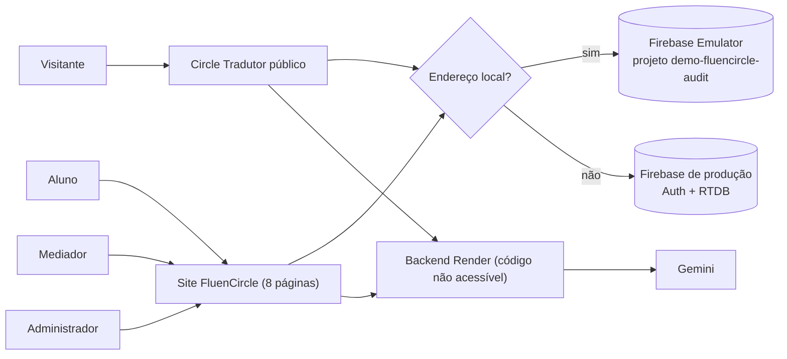

**Leitura:** o tradutor público lê `current_session`; gravar card sem login é **negado pela proposta de regras** e
desligado no Emulator. Em produção a tentativa direta existe só por compatibilidade com regras desconhecidas.

## D2 — Camadas do frontend (AS-IS)

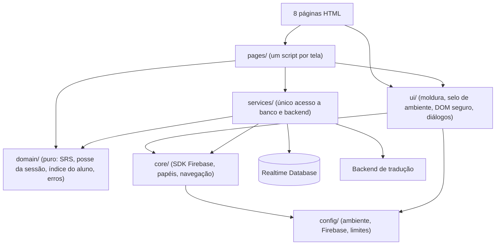

`scripts/verify-architecture.mjs` impede import do CDN fora de `core/`, caminhos do banco fora de `services/`,
imports em `domain/` e sinks HTML.

## D3 — Modelo lógico de dados (AS-IS)

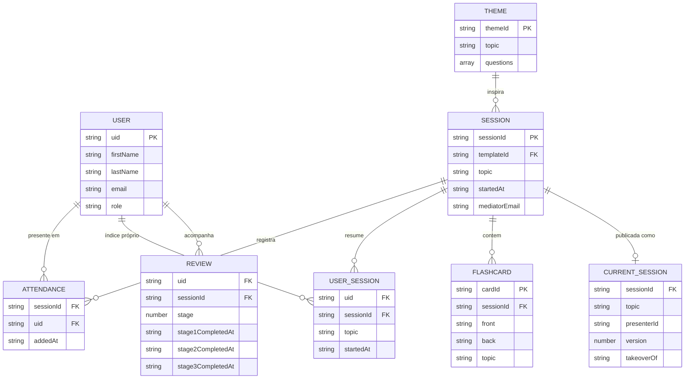

**Observações:** o RTDB é uma árvore JSON, não um banco relacional. `ATTENDANCE` = `meeting_sessions/{id}/attendees/{uid}`
(só `addedAt`; dados antigos podem ter nome/e-mail). `USER_SESSION` = `user_sessions/{uid}/{id}` (resumo; antigo: `true`).
`CURRENT_SESSION` tem também `startedAt` e `live/{presenterId}`.

## D4 — Tradutor público (AS-IS)

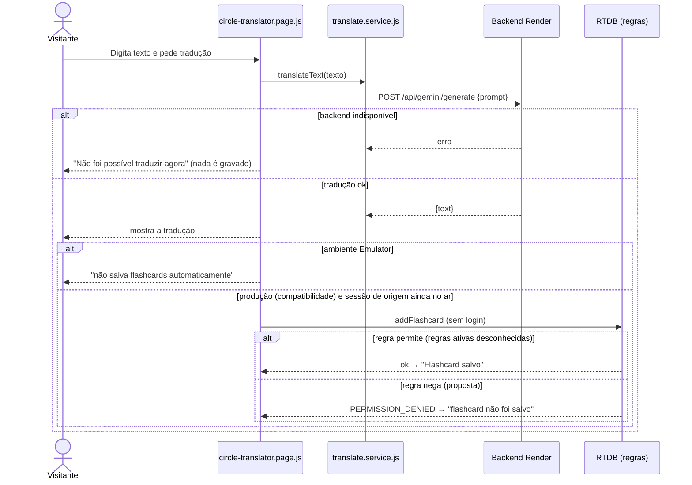

## D5 — Tradução pública com backend controlado (TO-BE)

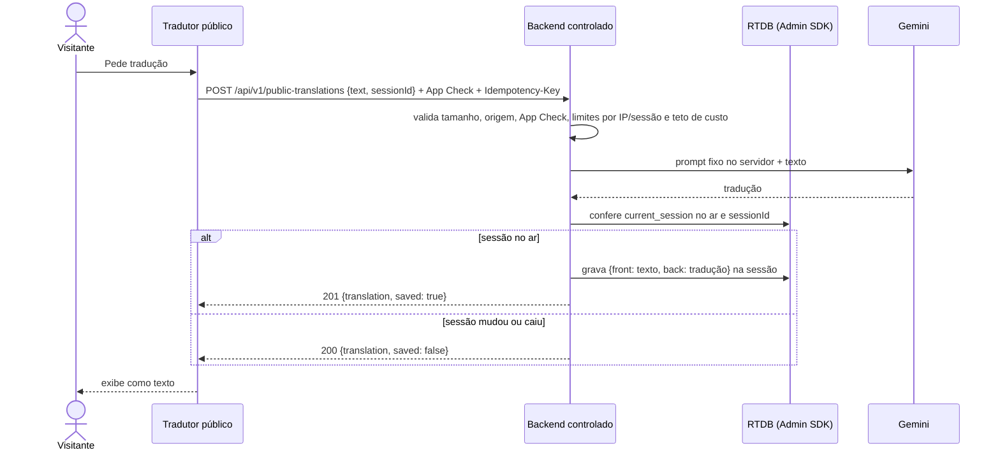

Contrato completo: `docs/backend/CONTRATO_BACKEND.md`.

## D6 — Ciclo da publicação no tradutor, por aba (AS-IS, ADR-003)

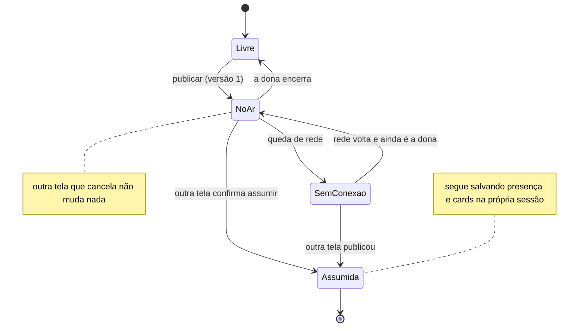

Transações e regras: publicar grava versão 1 (ou +1 sobre dono ausente); assumir exige versão +1 e `takeoverOf`;
a queda dispara o `onDisconnect` que apaga só `live/{aba}`; só a dona remove o nó.

## D7 — Revisão espaçada (AS-IS)

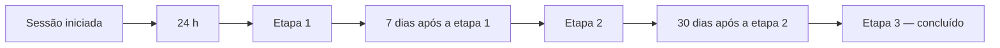

Regra de domínio em `domain/srs.js`. A proposta de regras só aceita avançar **uma** etapa por vez, com carimbo ISO,
em sessão de que o aluno participou; prazos não são verificáveis nas regras (datas em texto).

## D8 — Casos de uso (AS-IS)

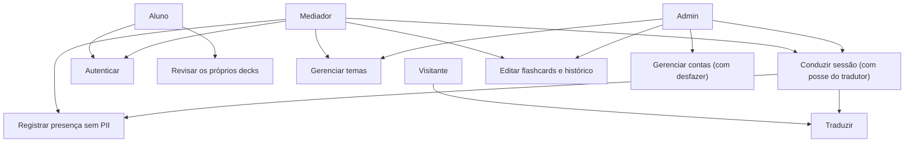

## D9 — Exclusão atômica de sessão (AS-IS)

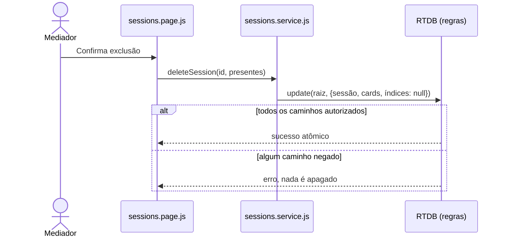

## D10 — Seleção de ambiente (AS-IS, ADR-002)

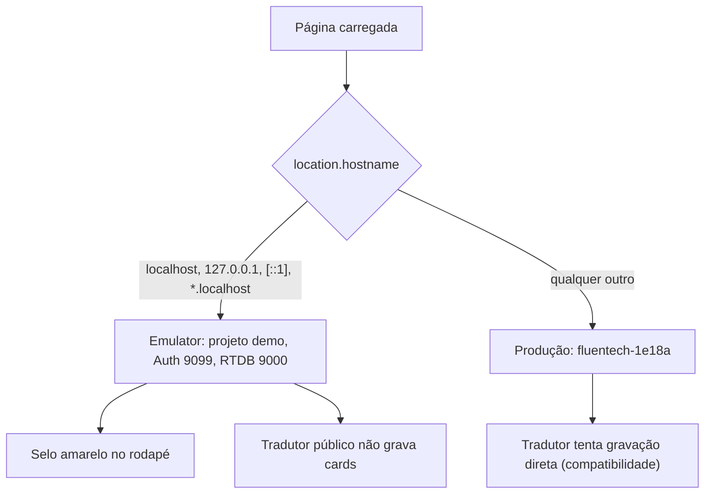

## D11 — Publicar e assumir o tradutor (AS-IS, ADR-003)

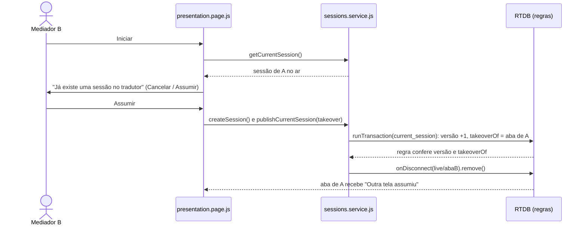

## D12 — Leitura mínima do aluno (AS-IS, ADR-004)

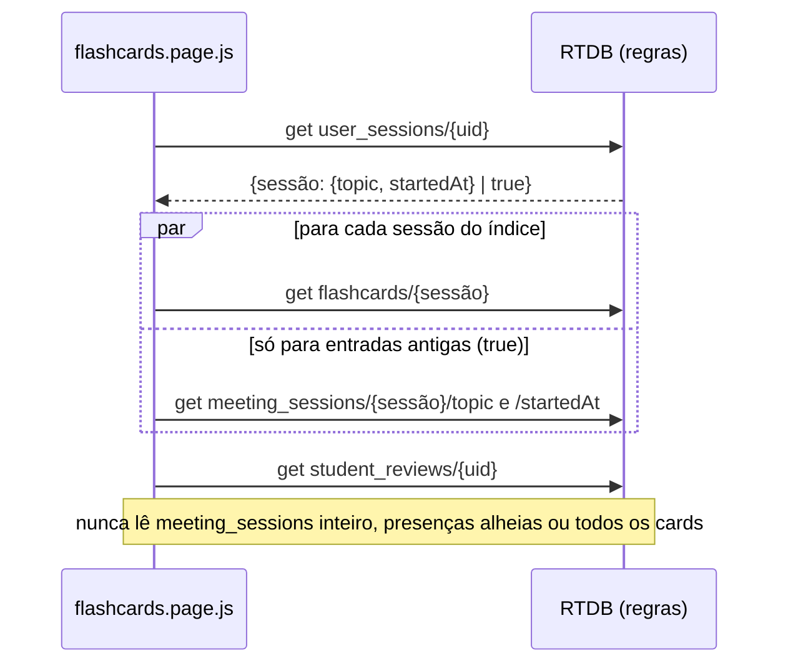

## D13 — Verificações na CI (AS-IS configurado)

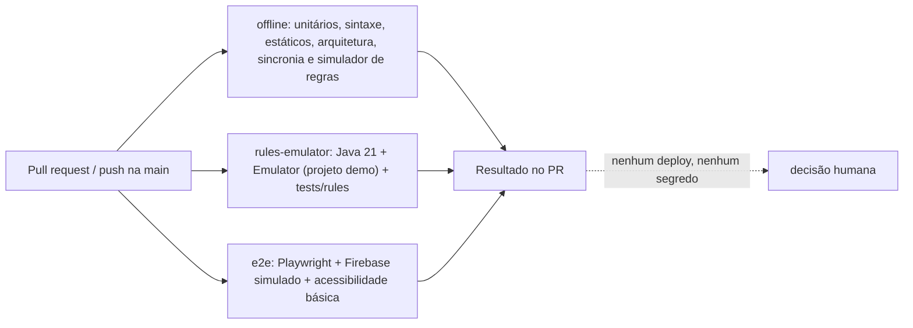

## D14 — Salas por código e QR (TO-BE, ADR-003)

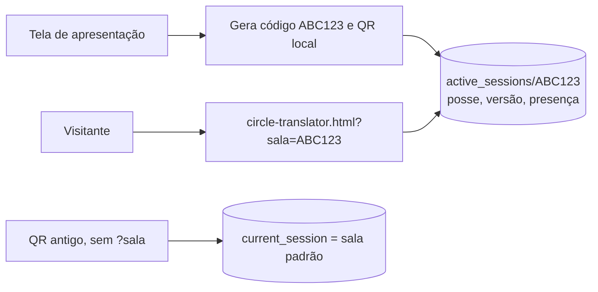

## Validação

- [x] Sintaxe conferida com `mmdc` nesta entrega (ver `docs/entrega/MATRIZ_DE_TESTES.md`).
- [ ] Atores e permissões confirmados pelos responsáveis e pelo job `rules-emulator`.
- [ ] Atualizar sempre que mudar esquema, endpoint, fluxo ou papel.
