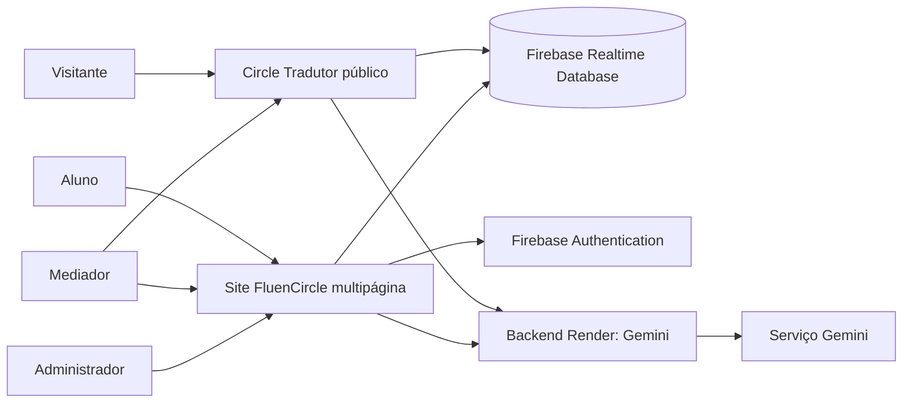
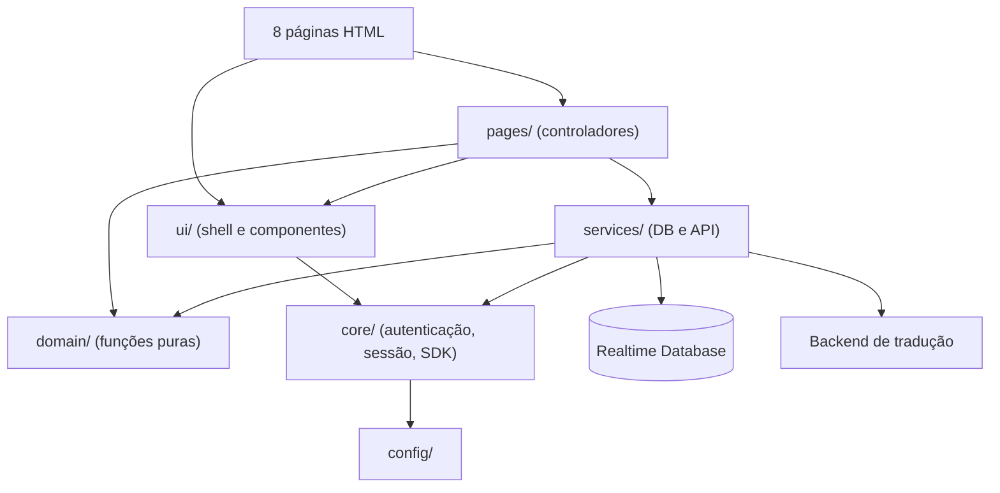
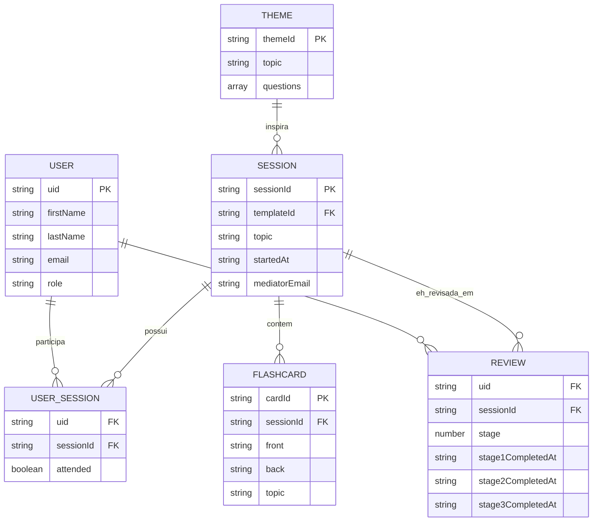
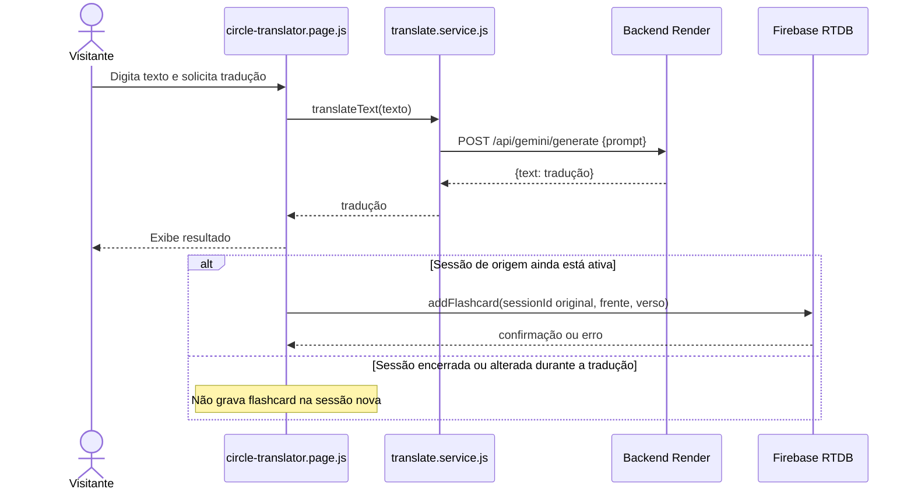
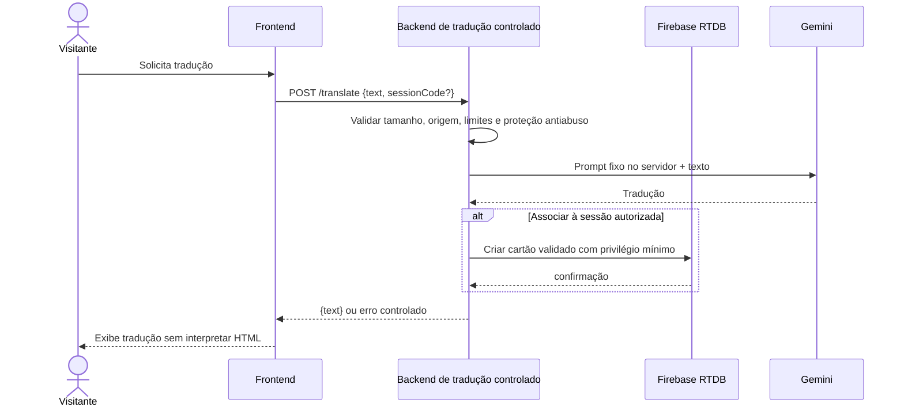
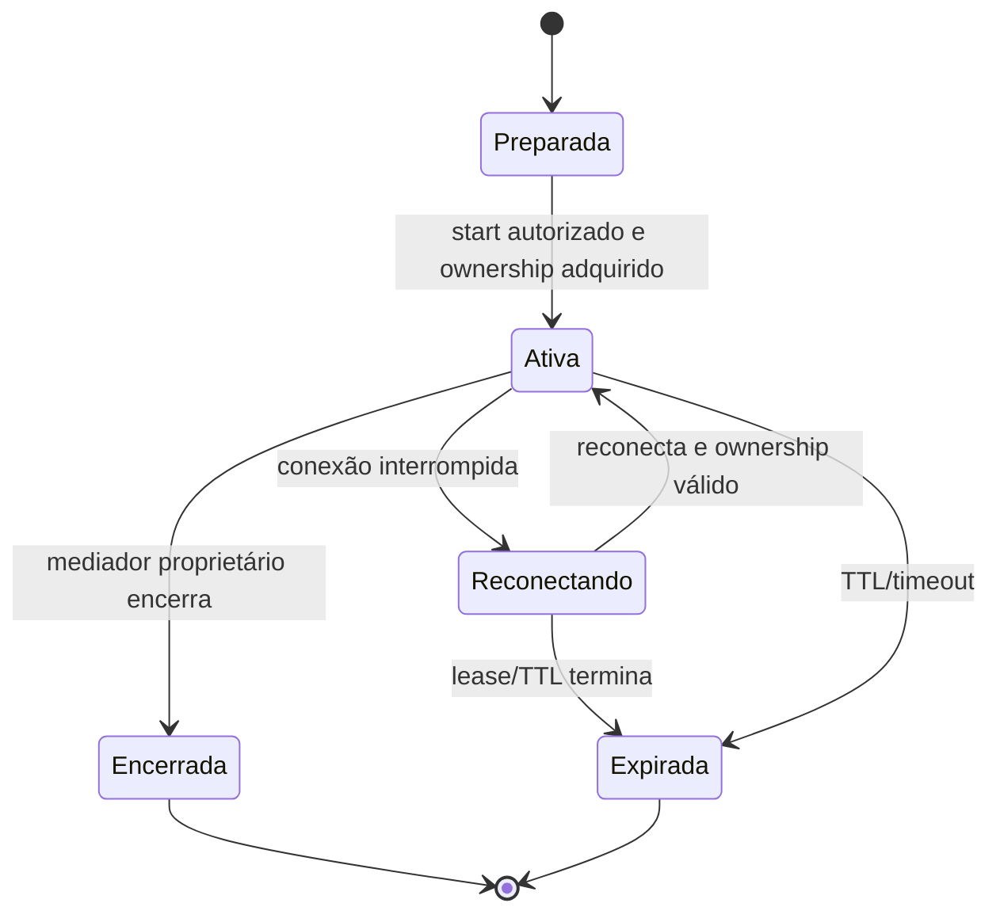
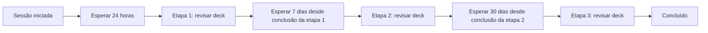
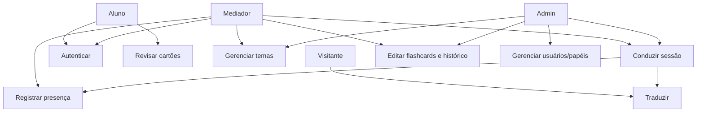
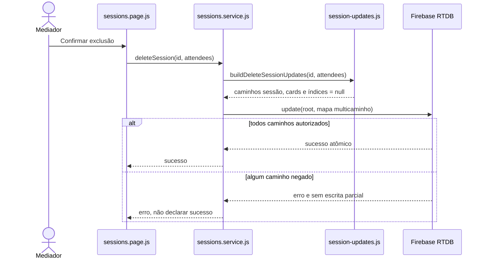

# Diagramas técnicos — FluenCircle

**Fonte:** main após reorganização Claude (PR #2) e reparos localizados de integridade/UX por ChatGPT (PR #16). Diagramas em Mermaid, renderizáveis no GitHub e editáveis como texto. **AS-IS** significa comportamento identificado no código; **TO-BE** significa sugestão, não funcionalidade existente.

## D1 — Contexto da aplicação (AS-IS)

**Pontos de atenção:** `PT → DB` permite gravação sem login conforme o código/proposta; o acesso de `WEB → DB` depende de regras ativas não analisadas. `API` foi visto somente pelo contrato consumido no frontend.

## D2 — Camadas do frontend reorganizado (AS-IS)

**Regra alvo:** o domínio não depende de browser nem de Firebase; operações de banco ficam em `services/`. Conferir imports em CI e criar ADR da escolha sem build versus Vite.

## D3 — Modelo lógico de dados (AS-IS, inferido do código)

**Observação:** ERD é representação conceitual: Firebase RTDB é uma árvore JSON, não SGBD relacional. O índice de presença é duplicado em `meeting_sessions/{id}/attendees` e `user_sessions/{uid}/{id}`. Há também `deleted_users` e nó singular `current_session` (não mostrados nas entidades principais).

## D4 — Sequência de tradução pública (AS-IS)

**Risco:** o fluxo atual não autentica o visitante na gravação do banco nem envia token de identificação ao backend de tradução. Ações de segurança são necessárias antes de publicação.

## D5 — Tradução pública com segurança (TO-BE proposto)

**Decisão pendente:** gravação automática pode exigir opt-in/moderação, proteção por sessão ou autenticação anônima. O diagrama não é autorização para construir endpoint privilegiado sem revisão de ameaças.

## D6 — Ciclo de vida da sessão (TO-BE para eliminar concorrência)

**Critérios:** IDs únicos, associação ao mediador, encerramento condicional, expiração e testes A/B concorrentes. Não usar remoção cega de um nó global compartilhado.

## D7 — Revisão espaçada (AS-IS)

**Regra de domínio:** `domain/srs.js`; o avanço é gravado em `student_reviews/{uid}/{sessionId}`. Necessário testar avanço concorrente e resistência a registros manipulados no cliente.

## D8 — Mapa resumido de casos de uso (AS-IS)

## Validação antes de aceitar diagramas

- [ ] Nomes dos nós e contratos checados contra código após merge.
- [ ] Atores e permissões confirmados por responsáveis e regras do Emulator.
- [ ] Todas as mudanças TO-BE registradas em Issues/ADRs.
- [ ] Diagramas atualizados sempre que mudar esquema, endpoint, fluxo ou papel.
## D9 — Exclusão atômica de sessão (AS-IS após PR #16)

**Limite:** a atomicidade do RTDB exige aceitação de todos os caminhos. Índices introduzidos concorrentemente após a leitura dos participantes ainda precisam de reconciliação. A CI offline apenas testa a construção do mapa.
